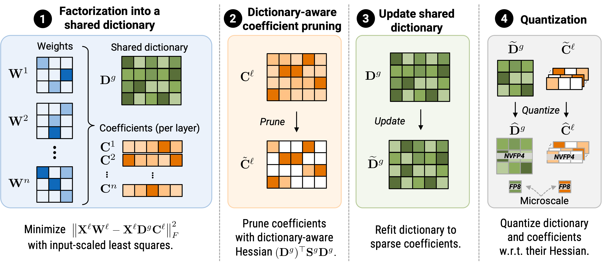

<div align="center">

# DictLLM : Post-training Compression of <br> Large Language Model with Dictionary Kernels <br> **NeurIPS 2026**

[Jinho Park](https://scholar.google.com/citations?user=vkWRJIAAAAAJ&hl=en)<sup>1</sup> &nbsp;&nbsp;&nbsp; 
[Se Young Chun](https://scholar.google.com/citations?user=3jLuG64AAAAJ&hl=en)<sup>2</sup> &nbsp;&nbsp;&nbsp; 
[Mingoo Seok](https://scholar.google.com/citations?user=OPECx0sAAAAJ&hl=en)<sup>1</sup>

<sup>1</sup>**Columbia University** &nbsp;&nbsp;&nbsp;&nbsp; 
<sup>2</sup>**Seoul National University**

</div>

<a href="https://arxiv.org/"></a>
[](https://jp4327.github.io/dictllm/)
[](./docs/assets/files/[NeurIPS%202026]%20DictLLM_slide_v1.pdf)
[](./docs/assets/files/[NeurIPS%202026]%20DictLLM_Poster_v1.pdf)

This repository contains the evaluation code for the following paper: 

[**DictLLM : Post-training Compression of Large Language Model with Dictionary Kernels**](https://arxiv.org/abs/2603.17979)




We propose a post-training compression method that expresses LLMs as shared dictionary across grouped layers and layer-specific coefficients, pushing the performance-model size frontier.

## Installation

Download and create a conda environment by running the following.
```bash
conda create -n qbasis python=3.11 -y
conda activate qbasis
```
Install core dependencies first.
```bash
pip install torch==2.11.0 torchvision==0.26.0 torchaudio==2.11.0
pip install transformers==4.45.1 accelerate==0.34.2 datasets==4.8.4
pip install safetensors==0.4.3 sentencepiece==0.2.0 peft==0.12.0
pip install numpy==1.26.3 scipy==1.13.1 pandas matplotlib scikit-learn
pip install protobuf
```
(Optional) If you want to pack weights into [QuTLASS](https://github.com/IST-DASLab/qutlass)-supported format, perform the following to install. Quantization code performs fake quantization without it.

<details>
<summary>Our setting required the following installations and environment variables set. Your may not need it.</summary>

```bash
conda install -c conda-forge gcc_linux-64=12 gxx_linux-64=12 ninja cmake -y
export CC="$CONDA_PREFIX/bin/x86_64-conda-linux-gnu-gcc"
export CXX="$CONDA_PREFIX/bin/x86_64-conda-linux-gnu-g++"
export CUDAHOSTCXX="$CXX"
export LIBRARY_PATH="/usr/local/cuda/lib64/stubs:$LIBRARY_PATH"
export LDFLAGS="-L/usr/local/cuda/lib64/stubs $LDFLAGS"
export LD_LIBRARY_PATH="/usr/local/cuda/lib64:$LD_LIBRARY_PATH"
```

</details>

```bash
git clone https://github.com/IST-DASLab/qutlass.git
cd ./qutlass
pip install --no-build-isolation -e .
```

Check if the installation is correct.
```bash
python -c "import transformers, datasets, torch; print(transformers.__version__, datasets.__version__, torch.__version__)"
python -c "from transformers.models.gpt2.modeling_gpt2 import GPT2SdpaAttention; print('basis ok')"
python -c "import qutlass; print('qutlass ok')"
```

Important notes:

- Keep `transformers==4.45.1` for compatibility.
- `datasets==4.8.4` worked in our case.
- Please re-run the `CC`/`CXX`/`LDFLAGS` exports in every new shell before rebuilding `qutlass`.

We have tested DictLLM under two environments:
- RHEL 8.10; Dual NVIDIA RTX PRO 6000 Blackwell Max-Q GPUs; CUDA runtime 13.0; NVCC 13.0.88; PyTorch 2.12.1+cu130; Transformers 4.55.4.
- RHEL 8.10; Dual NVIDIA RTX A6000 GPUs; CUDA runtime 12.8; NVCC 12.8.93; PyTorch 2.8.0+cu128; Transformers 4.45.1.

## Run model compression

Run the following from the repository root to perform factorization, Hessian pruning, dictionary refitting, and NVFP4 quantization:
```bash
CUDA_VISIBLE_DEVICES=0 bash scripts/run_llama7b.sh 2x --quantize
```
Change `checkpointing.policy` in the corresponding `recipes/*.yaml` file to control checkpoint retention: `final` (default), `all`, or `none`. 

Omit ``--quantize`` to stop after dictionary refitting. Quantization supports `fake` and `packed` export modes, configured in `recipes/*.yaml`. Fake export saves dequantized **NVFP4** values as **BF16** weights. Packed export stores in a [QuTLASS](https://github.com/IST-DASLab/qutlass)-compatible format and thus requires its installation as noted above.

## Evaluation
Evaluate C4 and PTB from the repository root using the command below, replacing the checkpoint and dataset paths as needed. Results are saved as `final_ppl_c4.json` and `final_ppl_ptb.json` inside the checkpoint directory; add `--overwrite` to rerun.

**Run C4**
```bash
CHECKPOINT=<replace with yours>
# CHECKPOINT=outputs/llama7b_wikitext_comp_gain_2x/03_refit

CUDA_VISIBLE_DEVICES=0 PYTHONPATH=src python -m dictllm.evaluate_c4_ptb \
  "$CHECKPOINT" --datasets c4
```

**Run PTB**
```bash
CHECKPOINT=<replace with yours>
# CHECKPOINT=outputs/llama7b_wikitext_comp_gain_2x/03_refit

CUDA_VISIBLE_DEVICES=0 PYTHONPATH=src python -m dictllm.evaluate_c4_ptb \
  "$CHECKPOINT" --datasets ptb --ptb-protocol research
```

(Some PTB evaluation protocols strip sentence-edge whitespace and joins sentences with two newlines. Keep preprocessing and tokenizer/BOS settings consistent, as these can change perplexity.)

## LM eval harness
Install with
```bash
python -m pip install -e '.[eval]'
```

Run LM eval harness with
```bash
CUDA_VISIBLE_DEVICES=0 bash scripts/run_lm_harness.sh \
  outputs/llama7b_wikitext_comp_gain_2x/03_refit
```

## Acknowledgements

This code is based on [Basis Sharing](https://github.com/TUDa-HWAI/Basis_Sharing), and uses [lm-evaluation-harness](https://github.com/eleutherai/lm-evaluation-harness) and [QuTLASS](https://github.com/IST-DASLab/qutlass). We thank the authors for sharing their codes.


## Reference

If you find our work useful in your research, please consider citing our paper:

> Jinho Park, Se Young Chun, Mingoo Seok, "DictLLM: Post-training Compression of Large Language Model with Dictionary Kernels", NeurIPS 2026

```bibtex
@inproceedings{park2026dictllm,
      title={{DictLLM: Post-training Compression of Large Language Model with Dictionary Kernels}},
      author={Park, Jinho and Chun, Se Young and Seok, Mingoo},
      booktitle={Advances in Neural Information Processing Systems},
      year={2026},
}
```
